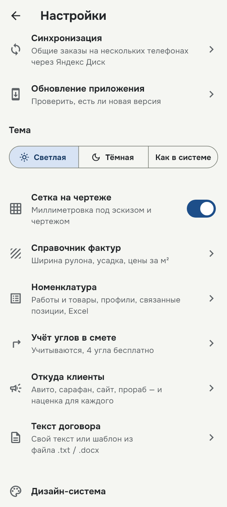
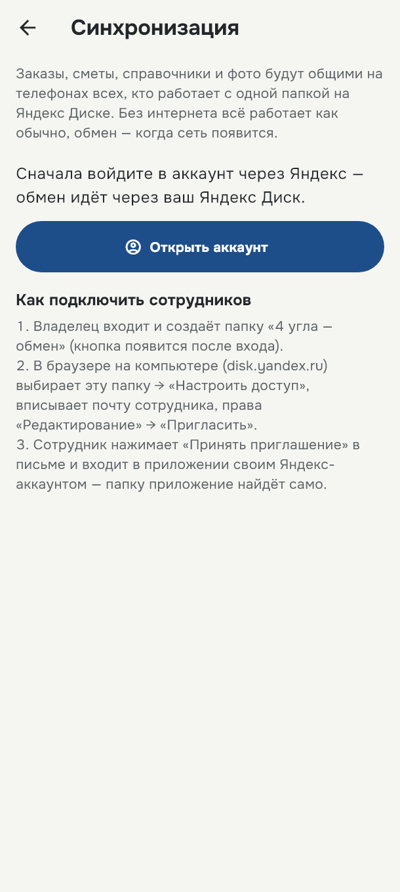
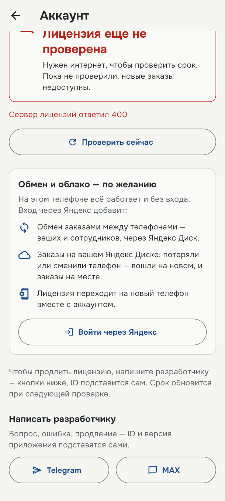
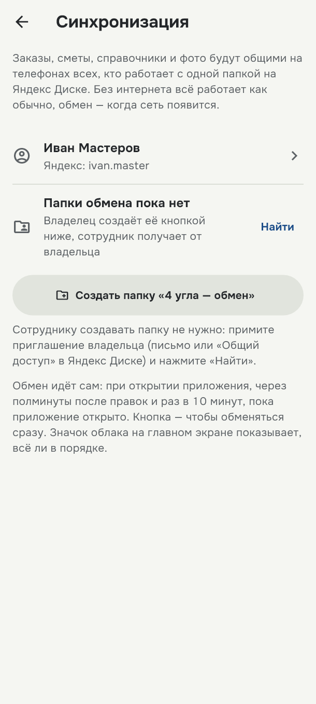
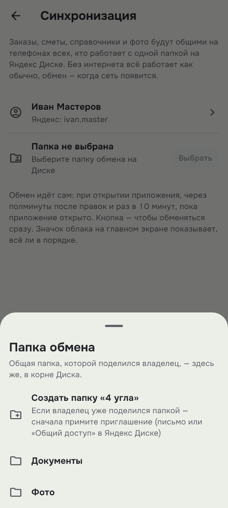
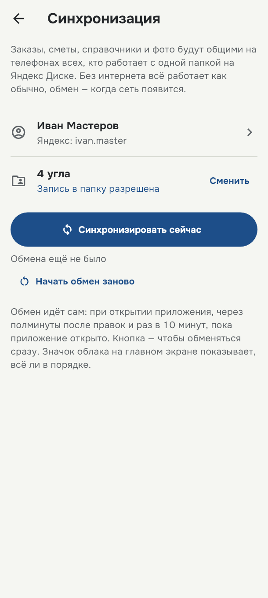
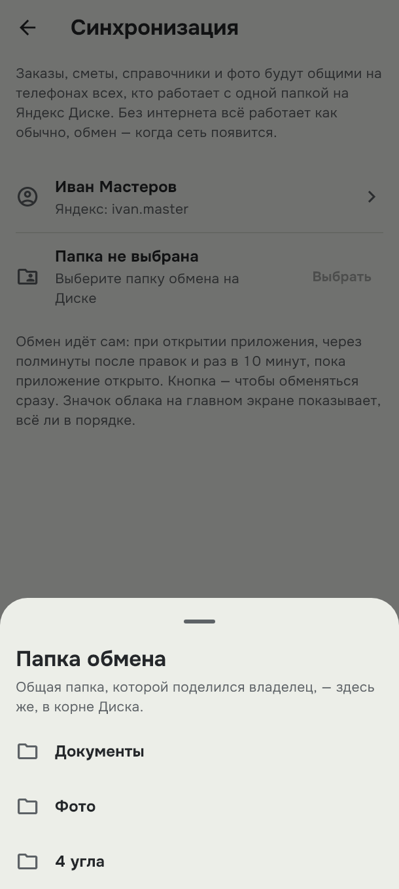

# Обмен заказами через Яндекс Диск

Заказы, сметы, справочники и фото становятся общими на телефонах всех, кто подключён к одной папке
на Яндекс Диске. Без интернета приложение работает как обычно, а обмен случится, когда сеть появится.

Что понадобится:

- аккаунт Яндекса с Диском — у каждого, кто будет обмениваться;
- владельцу один раз — компьютер с браузером, чтобы пригласить сотрудников;
- около 10 минут.

**Кто что делает**

| | |
| --- | --- |
| **Работаете один** | Только [часть 1](#часть-1-войти-и-создать-папку-обмена). Заказы будут храниться и на Диске: сменили телефон — вошли на новом, и всё на месте. На втором своём телефоне войдите тем же аккаунтом и выберите папку «4 угла». |
| **Вы владелец бригады** | [Часть 1](#часть-1-войти-и-создать-папку-обмена) у себя на телефоне, потом [часть 2](#часть-2-пригласить-сотрудников-в-папку) на компьютере. |
| **Вы сотрудник** | Дождитесь письма с приглашением от владельца и выполните [часть 3](#часть-3-принять-приглашение-и-подключиться). |

---

## Часть 1. Войти и создать папку обмена

*Владелец, на телефоне.*

### 1. Откройте «Синхронизацию»

На главном экране нажмите шестерёнку справа вверху, затем пункт **«Синхронизация»**.

### 2. Перейдите к входу

Пока вы не вошли, экран предлагает сначала войти. Нажмите **«Открыть аккаунт»**.

### 3. Войдите через Яндекс

В карточке **«Обмен и облако — по желанию»** нажмите **«Войти через Яндекс»**. Откроется окно Яндекса:

- выберите свой аккаунт или войдите в него;
- разрешите доступ: приложению нужен ваш Яндекс Диск и имя, чтобы показать, кто вошёл.

После входа вернитесь назад, в «Синхронизацию».

> Лицензия этого телефона при входе перейдёт на аккаунт. Заказы, которые уже есть в телефоне, никуда не денутся.

### 4. Выберите папку

Теперь на экране видно, кто вошёл, и строка **«Папка не выбрана»**. Нажмите **«Выбрать»**.

### 5. Создайте папку «4 угла»

Внизу откроется список папок вашего Диска. Нажмите первую строку — **«Создать папку «4 угла»»**.
Папка появится в корне Диска.

### 6. Проверьте, что всё готово

Под названием папки должна быть синяя надпись **«Запись в папку разрешена»**. Первый обмен начнётся
сам: телефон отправит в папку все свои заказы.

Дальше обмен идёт без вас: при открытии приложения, через полминуты после правок и раз в 10 минут,
пока приложение открыто. Кнопка **«Синхронизировать сейчас»** нужна, только чтобы обменяться сразу.

---

## Часть 2. Пригласить сотрудников в папку

*Владелец, в браузере на компьютере.* Яндекс разрешает открывать доступ к папке только в браузере
на компьютере — в приложении Яндекс Диска и в «4 угла» этого сделать нельзя.

### 1. Откройте Диск

Зайдите на [disk.yandex.ru](https://disk.yandex.ru) под тем же аккаунтом, с которым вошли в
приложении. В списке файлов найдите папку **«4 угла»**.

### 2. Пригласите сотрудника

**Выделить «4 угла» → «Настроить доступ» → почта сотрудника → «Редактирование» → «Пригласить»**

- Выделите папку и нажмите **«Настроить доступ»** на верхней панели (или в меню по правой кнопке мыши).
- Впишите адрес почты сотрудника на Яндексе. Если аккаунта у него нет, Яндекс предложит зарегистрироваться.
- Выберите права **«Редактирование»** и нажмите **«Пригласить»**.

Повторите для каждого сотрудника.

> ⚠️ С правами **«Просмотр»** обмен работать не будет: телефон сотрудника не сможет записывать в
> папку, и приложение напишет «Нет права записи в папку». Нужны права «Редактирование».

---

## Часть 3. Принять приглашение и подключиться

*Сотрудник.*

### 1. Примите приглашение

На почту придёт письмо от Яндекс Диска. Нажмите в нём **«Принять приглашение»** — откроется Диск.
Там ещё раз нажмите **«Принять приглашение»** вверху экрана. После этого папка «4 угла» появится и
на вашем Диске.

> Общая папка занимает место только на Диске владельца. Но совсем без свободного места на вашем
> Диске записывать в неё не получится — оставьте хотя бы немного.

### 2. Войдите в приложении своим аккаунтом

Как в части 1: шестерёнка → **«Синхронизация»** → **«Открыть аккаунт»** → **«Войти через Яндекс»**.
Входите тем аккаунтом, на почту которого пришло приглашение.

### 3. Выберите общую папку «4 угла»

Вернитесь в «Синхронизацию», нажмите **«Выбрать»** и выберите в списке папку **«4 угла»** — это и
есть общая папка владельца. Должна появиться надпись **«Запись в папку разрешена»**, и начнётся
первый обмен: к вам придут заказы бригады, от вас — ваши.

> ⚠️ Если в списке нет папки «4 угла», а первой строкой стоит **«Создать папку «4 угла»»** —
> приглашение ещё не принято. Не создавайте папку сами: получится своя отдельная папка, и обмена с
> бригадой не будет. Вернитесь к шагу 1.

---

## Значок облака на главном экране

После настройки рядом с шестерёнкой появится облако. Оно показывает, как прошёл обмен; нажмите на
него, чтобы открыть «Синхронизацию».

| Значок | Что значит |
| --- | --- |
| Облако с галочкой | Всё в порядке, обмен прошёл |
| Облако со стрелками | Идёт обмен |
| Перечёркнутое облако | Нет интернета — обменяется, когда появится сеть |
| Красный значок | Обмен не удался — откройте «Синхронизацию», там написано, что не так |

## Если что-то не так

| Сообщение | Что делать |
| --- | --- |
| «У аккаунта нет Яндекс Диска» | Аккаунт создан по номеру телефона (например, через Яндекс Go или Еду) — у таких нет Диска. Откройте [disk.yandex.ru](https://disk.yandex.ru) в браузере под этим аккаунтом, завершите регистрацию (придумайте логин или пароль) и войдите в приложении снова. |
| «Нет права записи в папку» | Владелец дал права «Просмотр». Пусть на disk.yandex.ru выделит папку, нажмёт «Настроить доступ» и поменяет вам права на «Редактирование». |
| «Папки нет на Диске» | Владелец закрыл доступ, или папку переименовали либо удалили. Попросите владельца пригласить вас снова, примите приглашение и выберите папку заново кнопкой «Сменить». |
| «Вход в Яндекс устарел» | Откройте «Синхронизацию» → «Открыть аккаунт» и войдите через Яндекс ещё раз. Папку выбирать заново не нужно. |
| Чьих-то заказов не видно | Проверьте значок облака у обоих: он должен быть с галочкой. Нажмите «Синхронизировать сейчас» сначала на телефоне, где заказ создан, потом на своём. Если не помогло — «Начать обмен заново»: телефон заново отправит и примет все данные, ничего не удаляется. |
| Сотрудник ушёл из бригады | На disk.yandex.ru выделите папку «4 угла» → «Настроить доступ» и уберите его. Новые заказы к нему больше не попадут. То, что уже было у него в телефоне, там и останется. |

---

Подробнее о доступе к папкам — в справке Яндекса:
[Настроить общую папку](https://yandex.ru/support/disk/share/shared-folders.html) и
[Меня пригласили в общую папку](https://yandex.ru/support/disk/share/shared-folders-to-me.html).

Инструкция для версии 4 угла 0.1.2 и новее.
